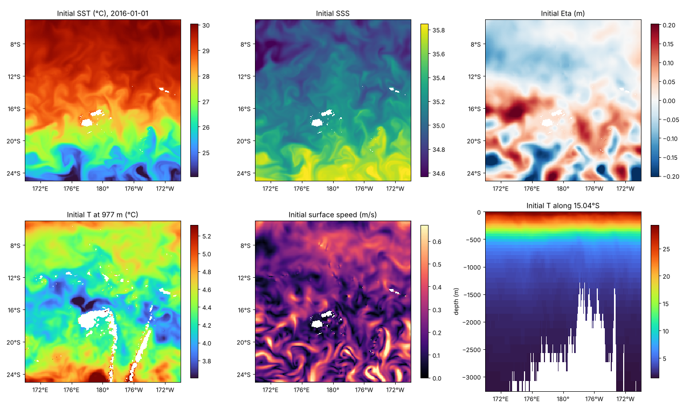
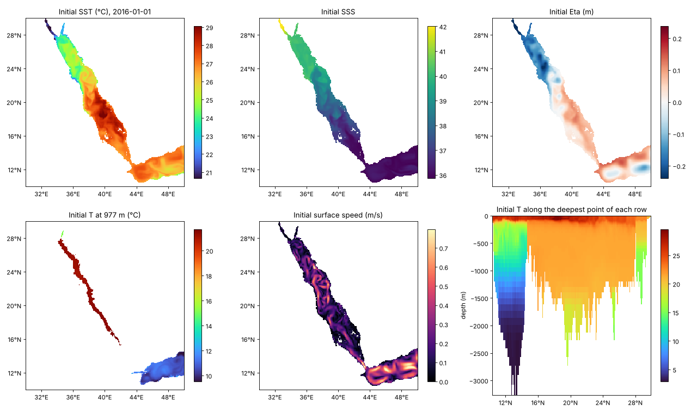
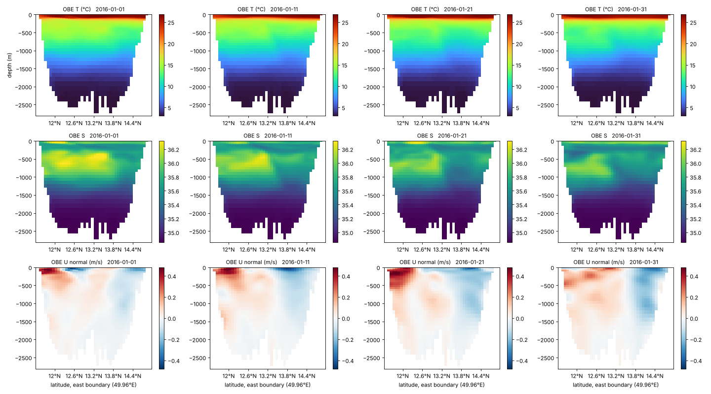
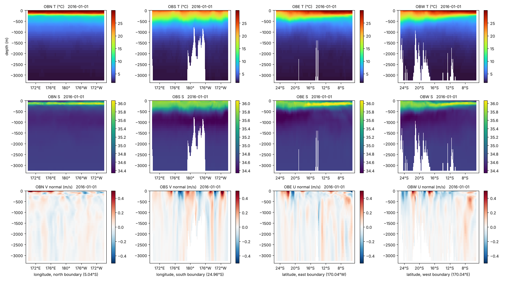

# make_ic_obc_mitgcm

Python scripts that build **initial conditions (IC)** and **open-boundary conditions (OBC)**
for the [MITgcm](https://mitgcm.org) ocean model from the
[GLORYS12V1](https://doi.org/10.48670/moi-00021) global ocean reanalysis (1/12°) of the Copernicus Marine Service.

You give it a model grid and bathymetry plus GLORYS NetCDF files. It writes MITgcm-ready binary files
for temperature, salinity, velocity and sea surface height. It also writes the matching namelist lines and
quick-look figures for checking the result.



## Features

- **Any longitude convention, including domains that cross the date line.** GLORYS can arrive as
  170..190, as −180..180 with a jump, or as separate files either side of 180°. Your `xgOrigin` can be
  written as 170 or −190. The script lines everything up.
- **Several files per date** are joined along longitude automatically.
- **Any combination of open boundaries** (N, S, E, W), following MITgcm's OBCS conventions.
- **Careful filling of gaps** where the model's coastline or seafloor differs from GLORYS. Gaps are filled
  only from water connected at the same depth, so the water in a basin behind a sill (e.g. the deep Red Sea)
  is never filled with water from the other side of the sill.
- **Volume conservation:** an optional uniform correction to the boundary-normal velocity makes the
  net inflow zero at each record. Without it, a regional model's sea level can drift by tens of cm per day.
- **Writes `namelist_snippets.txt`**, with the matching lines for `data`, `data.obcs`, `data.cal` and `data.exf`.
- **Quick-look figures and checks** (`plot_ic_obc.py`): NaN counts, value ranges, maps, sections
  and boundary slices.

## Requirements

- Python ≥ 3.8 with `numpy`, `scipy` and `matplotlib`
- The HDF5 C library (`libhdf5`), version 1.10 or newer. GLORYS files are NetCDF-4 (HDF5). `h5read.py` reads them
  through `ctypes`, so the Python packages `netCDF4`, `h5py` and `xarray` are **not** needed. libhdf5 is
  usually already installed alongside netCDF or HDF5 tools. If not: `apt install libhdf5-dev`,
  `brew install hdf5` or `conda install hdf5`.
- To download data: [`copernicusmarine`](https://help.marine.copernicus.eu/en/collections/9080063-copernicus-marine-toolbox)
  (`pip install copernicusmarine`, then `copernicusmarine login` once) and a free Copernicus Marine account

## Repository layout

```
make_ic_obc.py         main script: GLORYS -> MITgcm IC/OBC binaries + namelist_snippets.txt
plot_ic_obc.py         quick-look figures and checks for the output
h5read.py              minimal NetCDF-4/HDF5 reader (ctypes + libhdf5)
download_glorys.py     example download for a box crossing the date line
config_redsea.py       example 1: Red Sea, east boundary open
config_pacific.py      example 2: SW Pacific across the date line, four boundaries open
bathy_redsea.bin       example bathymetries (250 x 250, big-endian float32, negative = ocean)
bathy_pacific.bin
glorys_redsea/         GLORYS input for example 1 (+ the download script used)
glorys_pacific/        GLORYS input for example 2 (+ the download script used)
out_redsea/            output of example 1
out_pacific/           output of example 2
docs/figures/          figures used in this README
```

## Quick start

```bash
# 1. get GLORYS for your domain (+ ~0.5 deg margin) and period -- see "Downloading GLORYS"
# 2. describe your grid in a config file (copy one of the examples)
# 3. build the files
python3 make_ic_obc.py config_pacific.py
# 4. check them
python3 plot_ic_obc.py config_pacific.py
# 5. copy out_pacific/*.bin to your MITgcm input/ directory and add the lines
#    from out_pacific/namelist_snippets.txt to your namelists
```

Run the scripts from the repository folder: paths in the config files are relative to where you run them.
Each example takes about 10 seconds.

## The config file

A config file is plain Python, run by both scripts. Copy the values from your MITgcm `data` / `SIZE.h`.

| Setting | Meaning |
|---|---|
| `GLORYS_FILES` | glob pattern (or list of patterns) for the GLORYS NetCDF files |
| `BATHY` | model bathymetry file, Ny × Nx, negative = ocean |
| `OUT` | output directory |
| `Nx, Ny` | horizontal grid size (`SIZE.h`) |
| `xgOrigin, ygOrigin` | grid origin, degrees (`&PARM04`) |
| `delX, delY` | grid spacing, degrees: a single number or a list of Nx / Ny values |
| `delR` | layer thicknesses, metres (`&PARM04`); Nr = `len(delR)` |
| `OPEN_BOUNDARIES` | e.g. `'E'`, `'NSEW'`; boundaries run the full length of the domain edge |
| `HFACMIN, HFACMINDR` | match `&PARM01`; used for the transport correction (default 1.0, 0.0) |
| `ZERO_NET_TRANSPORT` | `True` (default): make the net inflow through the boundaries zero at each record |

Optional: `MARGIN` (degrees of GLORYS kept around the domain, default 0.5), `BATHY_DTYPE` /
`OUT_DTYPE` (default `'>f4'`; use `'>f8'` for real*8), `VARS` (to rename NetCDF variables, e.g.
`VARS = dict(lon='lon', lat='lat')`), and `PLOT_SECTION` (used only by `plot_ic_obc.py`; see below).

## Output

All files are big-endian float32 by default (MITgcm's default `readBinaryPrec = 32`). Shapes are listed
slowest dimension first, as NumPy reads them.

| File | Shape | Content |
|---|---|---|
| `T_ic.bin`, `S_ic.bin` | (Nr, Ny, Nx) | potential temperature (°C), salinity, from the first GLORYS record |
| `U_ic.bin` | (Nr, Ny, Nx) | zonal velocity at U points (XG, YC), m/s |
| `V_ic.bin` | (Nr, Ny, Nx) | meridional velocity at V points (XC, YG), m/s |
| `Eta_ic.bin` | (Ny, Nx) | sea surface height, m |
| `OB{N,S}_{T,S,U,V}.bin` | (nt, Nr, Nx) | northern / southern boundary, one record per GLORYS time |
| `OB{E,W}_{T,S,U,V}.bin` | (nt, Nr, Ny) | eastern / western boundary |
| `OB?_Eta.bin` | (nt, Nx or Ny) | boundary SSH (only read by MITgcm with `NONLIN_FRSURF`) |
| `namelist_snippets.txt` | | namelist lines matching these files |
| `meta.npz` | | grid, masks and dates (used by `plot_ic_obc.py`) |

Boundary values sit where MITgcm's OBCS package expects them. T, S and the tangential velocity are on
the boundary cell. The normal velocity is at face `OB_Ie` / `OB_Jn` on the east and north sides, and at
`OB_Iw+1` / `OB_Js+1` on the west and south sides.

## Setting up MITgcm

`namelist_snippets.txt` has the exact lines. In summary:

- `code/packages.conf`: `obcs`, `exf`, `cal`. In `code/OBCS_OPTIONS.h`: `#define ALLOW_OBCS_PRESCRIBE`.
- `input/data`, `&PARM05`: `hydrogThetaFile`, `hydrogSaltFile`, `uVelInitFile`, `vVelInitFile`, `pSurfInitFile`.
- `input/data.obcs`: `OB_Ieast = Ny*-1` (etc.), `useOBCSprescribe = .TRUE.`, and the `OB?tFile`,
  `OB?sFile`, `OB?uFile` and `OB?vFile` names.
- `input/data.cal` and `input/data.exf` (`&EXF_NML_OBCS`): start date and record spacing.

**Why exf?** GLORYS records are snapshots (e.g. 00:00 every 10 days). With exf, record *n* sits at
`startdate + (n-1)*period` and exf interpolates linearly between records, which is exactly right.
MITgcm's built-in periodic forcing (`periodicExternalForcing`, `externForcingPeriod` and
`externForcingCycle` in `&PARM03`) also works without exf, but it treats each record as the middle of its period
and cycles back to the first record at the end. That puts the timing off by half a period.

With several open boundaries, consider a sponge layer (`useOBCSsponge`, `&OBCS_PARM03`) and
`useOBCSbalance`.

## Downloading GLORYS

Download a box about 0.5° larger than your domain on every side, covering all depths and your run period.
You need the variables `thetao`, `so`, `uo`, `vo` and `zos`. Use the daily (`cmems_mod_glo_phy_my_0.083deg_P1D-m`) or monthly
(`..._P1M-m`) product. The records must be evenly spaced.

The scripts in `glorys_redsea/` and `glorys_pacific/` are the downloads used for the examples
(one snapshot per file). `download_glorys.py` shows a request across the date line: 170°W is written as **190**.
If your toolbox version rejects a range that crosses 180°, it downloads the two halves instead, and
`make_ic_obc.py` joins them back together.

```python
import copernicusmarine
copernicusmarine.subset(
    dataset_id="cmems_mod_glo_phy_my_0.083deg_P1D-m",
    variables=["thetao", "so", "uo", "vo", "zos"],
    minimum_longitude=169.5, maximum_longitude=190.5,      # 170E - 170W
    minimum_latitude=-25.5, maximum_latitude=-4.5,
    start_datetime="2016-01-01T00:00:00", end_datetime="2016-01-31T00:00:00",
    output_filename="glorys_pacific_201601.nc",
)
```

## Method

1. Crop GLORYS to the model domain + `MARGIN`, with all longitudes placed on one continuous axis starting at
   `xgOrigin`.
2. Interpolate each GLORYS column vertically (linear) to the model's layer centres. Above the first GLORYS
   level (0.5 m), use the surface value.
3. Interpolate horizontally (bilinear, ignoring land) to the model's C, U and V points.
4. Fill gaps, level by level from the top: (a) spread values sideways, only through cells that are ocean
   in the model at that depth; (b) cells still empty take the value from the level above. Land: T, S and
   Eta take the nearest value (harmless, and avoids zeros); U and V are set to 0.
5. Optionally, add a uniform velocity to the boundary-normal flow so the net inflow is zero at each record.
   Faces in corner cells are left out of the sum.
6. Subtract the initial domain-mean SSH from both the initial and boundary SSH (GLORYS `zos` has an arbitrary reference).

## Examples

### 1. Red Sea, east boundary open (`config_redsea.py`)

250 × 250 × 50, 30–50°E, 10–30°N, 0.08°, open at 50°E across the Gulf of Aden. Four snapshots, January 2016.
Interpolated as it is, GLORYS gives a net 0.4–1.3 Sv flowing out of this closed basin; the correction removes it.




### 2. Southwest Pacific across the date line (`config_pacific.py`)

250 × 250 × 50, 170°E–170°W, 25°S–5°S, 0.08°, all four sides open. Four snapshots, January 2016.
The example uses the same 50 levels as the Red Sea (bottom at 3263 m), so MITgcm flattens deeper water,
including the Tonga Trench. For real use, extend `delR` to your bathymetry's depth.



## Plotting (`plot_ic_obc.py`)

```bash
python3 plot_ic_obc.py config_file.py [--record N] [--outdir DIR]
```
This writes `check_IC.png` and `check_OBC.png` to the output folder and prints NaN counts and value ranges.
With one open side, the boundary figure shows up to four records; with several sides, it shows every side for one
record (`--record`, default 0). The section in the bottom-right panel is set by `PLOT_SECTION` in the config:
`'auto'` (default), `('lat', -15)`, `('lon', 180)` or `'deepest'` (follows the deepest point of each row; good for
long, narrow basins).

## Limitations and caveats

- Spherical-polar grids only, regional (not zonally periodic). No curvilinear or cubed-sphere grids.
- Open boundaries must run the full length of a domain edge.
- The zero-net-transport correction uses `HFACMIN`/`HFACMINDR` from the config. Set them to match your `data`
  file, or a small net flow will remain.
- **GLORYS has some odd values that are passed through unchanged.** Check the figures for your region.
  In the examples:
  - Gulf of Aqaba below about 500 m: 15–17°C (observed about 20.7°C)
  - deep Red Sea trench below about 1400 m: 15–18°C (observed about 21.6°C)
  - a pocket at about 220 m west of Viti Levu, Fiji: about −0.6°C
- The scripts read whole variables into memory. A very large domain or a long run may need the GLORYS data split
  into several downloads.

## Data citation

If you use GLORYS, please cite the product: E.U. Copernicus Marine Service Information,
Global Ocean Physics Reanalysis (GLOBAL_MULTIYEAR_PHY_001_030),
[doi:10.48670/moi-00021](https://doi.org/10.48670/moi-00021).

## License

Copyright (c) 2026 [Rui Sun]

Permission is hereby granted, free of charge, to any person obtaining a copy
of this software and associated documentation files (the "Software"), to deal
in the Software without restriction, including without limitation the rights
to use, copy, modify, merge, publish, distribute, sublicense, and/or sell
copies of the Software, and to permit persons to whom the Software is
furnished to do so, subject to the following conditions:

The above copyright notice and this permission notice shall be included in all
copies or substantial portions of the Software.

THE SOFTWARE IS PROVIDED "AS IS", WITHOUT WARRANTY OF ANY KIND, EXPRESS OR
IMPLIED, INCLUDING BUT NOT LIMITED TO THE WARRANTIES OF MERCHANTABILITY,
FITNESS FOR A PARTICULAR PURPOSE AND NONINFRINGEMENT. IN NO EVENT SHALL THE
AUTHORS OR COPYRIGHT HOLDERS BE LIABLE FOR ANY CLAIM, DAMAGES OR OTHER
LIABILITY, WHETHER IN AN ACTION OF CONTRACT, TORT OR OTHERWISE, ARISING FROM,
OUT OF OR IN CONNECTION WITH THE SOFTWARE OR THE USE OR OTHER DEALINGS IN THE
SOFTWARE.
